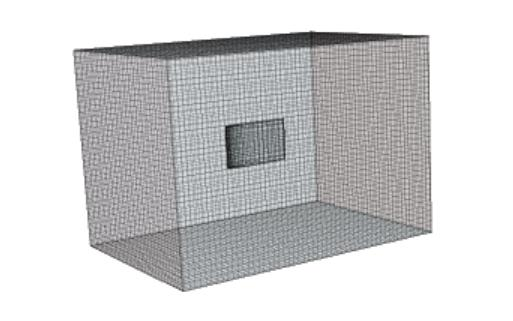
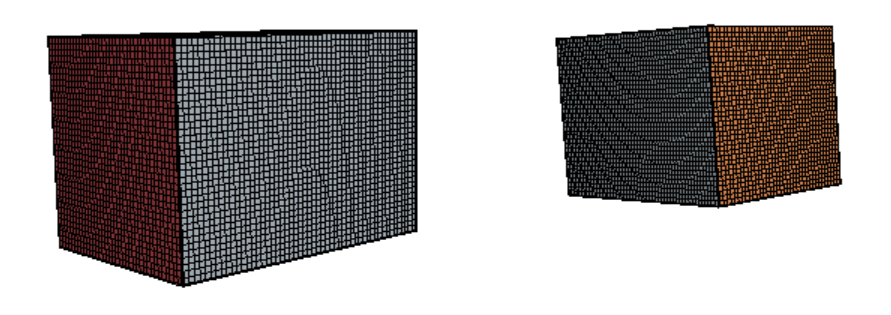
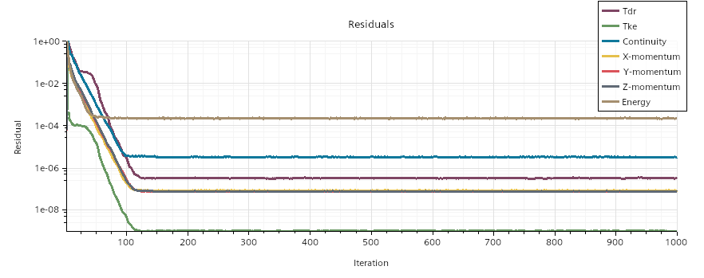
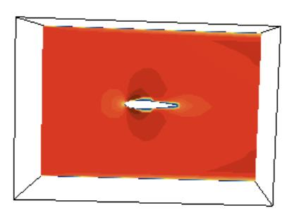
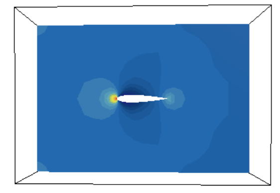
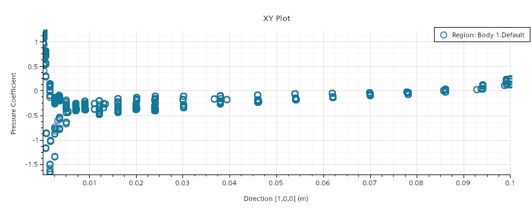
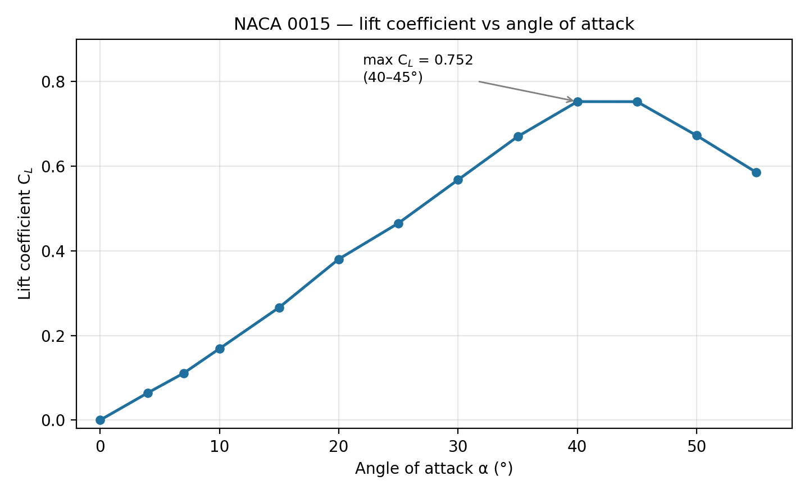

# NACA 0015 Wing Profile — STAR-CCM+ CFD Study (Lift vs Angle of Attack)

CFD simulation of the air flow around a NACA 0015 wing profile with STAR-CCM+: convergence checks, velocity and pressure fields at zero incidence, then a sweep of the angle of attack from 0° to 55° to build the lift curve and locate the stall.

**Author:** Yanis Boutabia — *IPSA Paris, "Initiation à la CFD" lab report (in French), March 2025.*

## Objective

Simulate the flow around a NACA 0015 profile to study the aerodynamic forces (lift and drag) and see how the lift coefficient evolves with the angle of attack up to stall. The lab covers the full CFD workflow: geometry, meshing, physics set-up, solving and post-processing.

## Set-up

- **Profile:** NACA 0015 (symmetric section, 15% thickness) in air
- **Baseline case:** V = 10 m/s, angle of attack α = 0°
- **Angle-of-attack sweep:** 13 cases at α = 0, 4, 7, 10, 15, 20, 25, 30, 35, 40, 45, 50 and 55°
- **Model:** steady flow solved with transport equations for turbulence (*Tke*, *Tdr*); residuals monitored for continuity, momentum, energy, *Tke* and *Tdr*
- **Mesh:** hexahedral mesh in a box-shaped domain (see views below)
- **Chord and Reynolds number:** the chord is not stated in the report; the pressure-coefficient plot spans 0 to 0.1 m along the chord, which gives c ≈ 0.1 m and Re ≈ 7×10⁴ at 10 m/s (computed with air ν ≈ 1.5×10⁻⁵ m²/s)

*Computational domain containing the wing*

*Mesh — view on the inlet face (red) and on the outlet face (orange)*

## Convergence (V = 10 m/s, α = 0°)

The residuals fall by about 4 to 5 orders of magnitude during the first 100 iterations and stabilize after about 200 iterations. The continuity and momentum residuals reach about 10⁻⁶ and the turbulence residuals are also well reduced. The lift force settles near zero and the drag force settles around 0.01 N within the first 50 to 100 iterations of the 1000 run. At α = 0° the converged lift coefficient is 9.1×10⁻⁶, which is zero for practical purposes, as expected for a symmetric profile at zero incidence.

*Residuals, V = 10 m/s, α = 0°*

## Flow fields at zero incidence

On the cut plane through the profile, the flow accelerates around it and a decelerated wake forms behind it. The pressure field shows the leading-edge stagnation region and the pressure gradient along the surface. The pressure coefficient along the chord varies strongly near the leading edge and flattens further downstream. The report attributes the dispersion of the points to a coarse mesh or to residuals that are not fully converged.

*Velocity magnitude on a cut plane showing the profile section, α = 0°*

*Static pressure on a cut plane showing the profile section, α = 0°*

*Pressure coefficient C_p along the chord, α = 0°*

## Lift curve

| α (°) | C_L |
|---|---|
| 0 | 9.1×10⁻⁶ |
| 4 | 0.0645 |
| 7 | 0.1108 |
| 10 | 0.1687 |
| 15 | 0.2660 |
| 20 | 0.3804 |
| 25 | 0.4652 |
| 30 | 0.5676 |
| 35 | 0.6698 |
| 40 | 0.7523 |
| 45 | 0.7522 |
| 50 | 0.6722 |
| 55 | 0.5851 |

*C_L versus angle of attack, plotted from the table above*

- **Linear rise:** C_L grows by about 0.019 per degree on average between 0° and 40°.
- **Maximum:** C_L peaks at about 0.75 between 40° and 45°, and the report places the stall angle around 45°.
- **Post-stall drop:** beyond 45° the lift falls, down 22% at 55°, consistent with flow separation.

## Limitations

- The span of the wing and the reference area used to normalize C_L are not documented in the report, so the absolute C_L values cannot be compared directly with published NACA 0015 data.
- The stall angle found here (about 45°) is much higher than the roughly 15° seen in wind-tunnel data for a 2D NACA 0015 section at Reynolds numbers around 10⁶. The possible causes (finite-wing effects, low Reynolds number, reference-area normalization, mesh resolution, steady solver at high incidence) were not investigated. The lab is best read as a study of the shape of the lift curve rather than a quantitative prediction.
- The report does not include a mesh-independence study or a comparison with reference data.

## Tools

`STAR-CCM+` — geometry, meshing, physics set-up, solving, post-processing

---
*Academic lab report — IPSA Paris, March 2025.*
